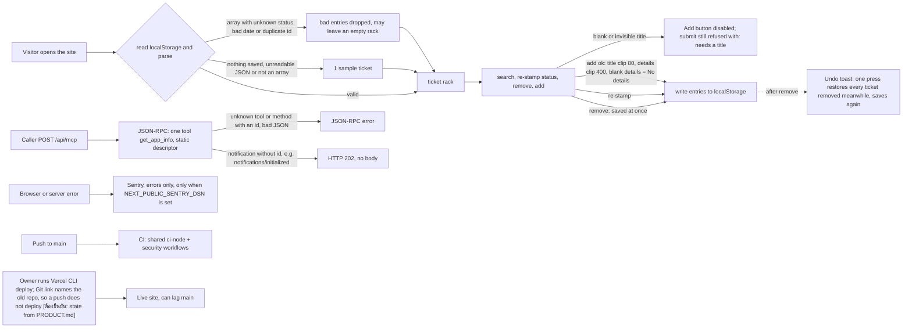
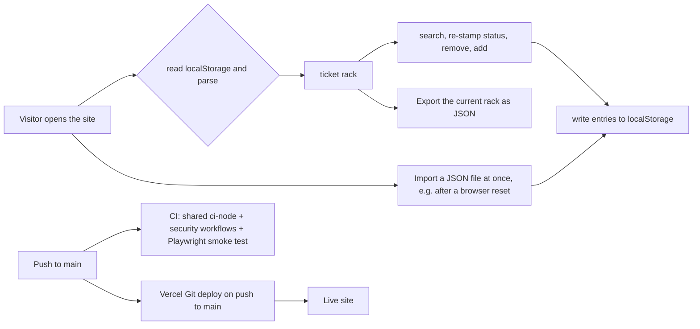

# 01 — Business process (As-Is / To-Be)

giveaways คือรายการ "ticket" ของ giveaway ที่เก็บใน `localStorage` ของ browser (เพิ่ม, ค้นหา, เปลี่ยนสถานะ Open/Draft/Closed, ลบ) เป็นเดโม CRUD สำหรับผู้เยี่ยมชม portfolio ไม่มีการรับ entry จากผู้เข้าร่วม ไม่สุ่มผู้ชนะ และไม่มีหน้าผลลัพธ์

Last reviewed: 2026-11-28 · commit `381584d`

## As-Is (จากโค้ดวันนี้)

Sources: `lib/entries.ts`, `lib/mcp.ts`, `app/api/mcp/route.ts`, `lib/site.ts`, `lib/sentry.ts`, `next.config.ts`, `.github/workflows/ci.yml`, `README.md`, `PRODUCT.md`

ข้อเท็จจริงจากโค้ด: `/more-projects` เป็น 308 ไป `https://bookchaowalit.com/` (README ยังบรรยายว่าเป็นหน้าแยก ซึ่งไม่ตรงกับ `next.config.ts`)

## To-Be (docs/UPGRADE-PLAN.md §Backlog, PRODUCT.md §Live URL and deploy state)

Sources: `docs/UPGRADE-PLAN.md`, `PRODUCT.md`

## Gap

| ID | As-Is → To-Be | Status | Owner | Evidence |
|---|---|---|---|---|
| G1 | Vercel deploy ด้วย CLI เท่านั้น (Git link ชี้ repo เก่า) ทำให้ push ไป main ไม่ deploy และ live ช้ากว่า main → Vercel Git deploy ทุกครั้งที่ push ไป main | blocked | owner | `PRODUCT.md` §Live URL and deploy state (owner action D9) |
| G2 | ไม่มี export/import ทำให้ ticket หายเมื่อ reset browser → export/import rack เป็น JSON (P2) | todo | claude | `docs/UPGRADE-PLAN.md` §Backlog |
| G3 | ไม่มี Playwright smoke test (add, search, re-stamp, remove) ใน CI → เพิ่ม smoke test เมื่อมี browser runner (P1) | todo | claude | `docs/UPGRADE-PLAN.md` §Backlog |
| G4 | ไม่มี To-Be ของกระบวนการแอปนอกเหนือ backlog (เช่น รับ entry จริง หรือสุ่มผู้ชนะ) → owner กำหนดหรือยืนยันว่าคงเป็นเดโม | decide | owner | `PRODUCT.md` §What does not work |

## Open questions

- P2 backlog เรื่อง self-host ฟอนต์ใน `docs/UPGRADE-PLAN.md` ไม่กระทบกระบวนการ จึงไม่ใส่เป็น gap
- สถานะ deploy ตรวจจาก `PRODUCT.md` (2026-10-23) ไม่ได้ตรวจกับ Vercel [ต้องยืนยัน]
